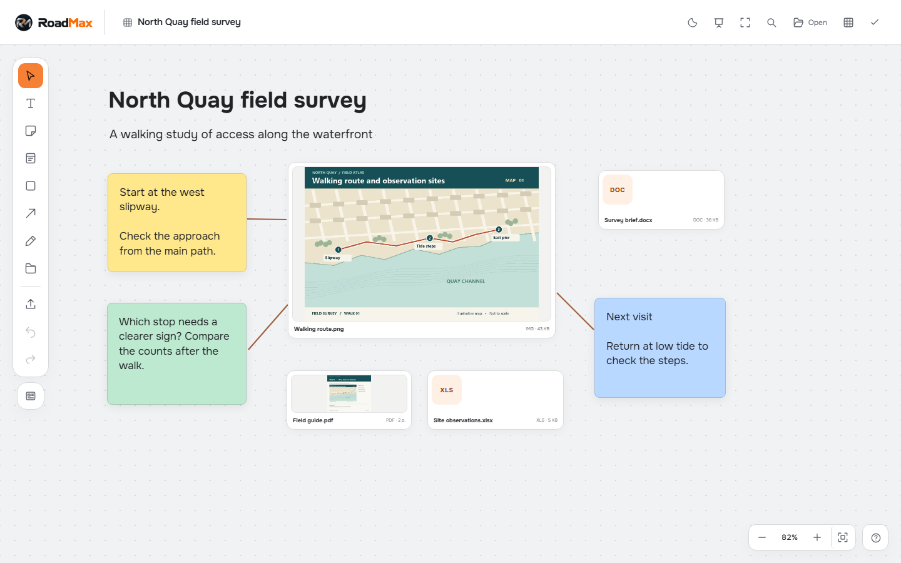

# RoadMax

[Русская версия](README.md)

RoadMax is an offline whiteboard for Windows and macOS. Pin a source PDF next to your notes, mark a passage, and draw an arrow to the decision it supports. Boards and attachments stay on your computer. This public repository hosts desktop downloads, examples and user documentation.

| Download RoadMax 2.3.24 | How to open it |
| --- | --- |
| [Windows 10/11 · x64 Portable](https://github.com/FORQO/RoadMax-Public/releases/download/v2.3.24/RoadMax-Portable-2.3.24.exe) | Run the EXE. |
| [macOS 13+ · Apple Silicon](https://github.com/FORQO/RoadMax-Public/releases/download/v2.3.24/RoadMax-2.3.24-macOS-arm64.dmg) | Open the DMG and drag RoadMax into Applications. |
| [macOS 13+ · Intel](https://github.com/FORQO/RoadMax-Public/releases/download/v2.3.24/RoadMax-2.3.24-macOS-x64.dmg) | Open the DMG and drag RoadMax into Applications. |

On a Mac, **About This Mac** shows whether you have an Apple chip or an Intel processor. The Windows executable is unsigned and the Mac builds are distributed without Apple notarization. To update, back up your work and quit the earlier version first. [Latest release and SHA-256 checksums](https://github.com/FORQO/RoadMax-Public/releases/latest)

*The board shows “North Quay field survey”, a demonstration project about access along a waterfront, in RoadMax 2.3.24.*

To choose a language, open **Language** (or **Язык**), select **English** or **Русский**, and confirm the restart. **Use system language** follows your system’s preferred languages. RoadMax uses English when none of them is supported.

## Try a board

1. [Download “One Street, Three Photographs” (ZIP)](https://github.com/FORQO/RoadMax-Public/raw/refs/heads/main/examples/one-street-en.zip) and extract the archive. It contains one board with four editable sticky notes for planning a small exhibition.
2. In RoadMax, choose **File → Open RoadMax project…** and select `one-street-en.roadmax` from the archive.
3. Add a photo or PDF next to **Source material**. Write down a detail you noticed and draw an arrow from the note to its source.

## Screenshots

| View | Light theme | Dark theme |
| --- | --- | --- |
| Board | [Light](assets/screenshots/2.3.24/en/board-light.webp) | [Dark](assets/screenshots/2.3.24/en/board-dark.webp) |
| Project library | [Light](assets/screenshots/2.3.24/en/library-light.webp) | [Dark](assets/screenshots/2.3.24/en/library-dark.webp) |
| PDF | [Light](assets/screenshots/2.3.24/en/pdf-light.webp) | [Dark](assets/screenshots/2.3.24/en/pdf-dark.webp) |
| Image editor | [Light](assets/screenshots/2.3.24/en/image-light.webp) | [Dark](assets/screenshots/2.3.24/en/image-dark.webp) |
| Spreadsheet | [Light](assets/screenshots/2.3.24/en/sheet-light.webp) | [Dark](assets/screenshots/2.3.24/en/sheet-dark.webp) |
| DOCX | [Light](assets/screenshots/2.3.24/en/docx-light.webp) | [Dark](assets/screenshots/2.3.24/en/docx-dark.webp) |

[Compare line and dot grids in both themes](assets/screenshots/2.3.24/en/grid.webp). Lines are on the left and dots on the right.

## Working with your own files

You can annotate PDFs and images and edit supported XLSX, CSV, TSV and DOCX files. Complex Office documents can open read-only. Text search in a PDF requires a text layer. RoadMax keeps original attachments separately from edited versions.

To move a board to another computer, choose **File → Save project to folder…** and copy the entire exported folder, including its attachments. Open the `.roadmax` file on the other computer.

[Official website](https://roadmax.dskforge.com/) · [File support and limitations · Russian](README.md#форматы-и-ограничения) · [Ask a question or report a problem](https://github.com/FORQO/RoadMax-Public/issues/new/choose)
