
 

<b>Идеи, планы и документы — в одном пространстве.</b> Локальное приложение для Windows и macOS от <a href="https://github.com/FORQO">FORQO</a>.

<b>Скачать RoadMax 2.3.21</b> <a href="https://github.com/FORQO/RoadMax-Public/releases/download/v2.3.21/RoadMax-Portable-2.3.21.exe">Windows x64 Portable</a> · <a href="https://github.com/FORQO/RoadMax-Public/releases/download/v2.3.21/RoadMax-2.3.21-macOS-arm64.dmg">Mac с Apple Silicon</a> · <a href="https://github.com/FORQO/RoadMax-Public/releases/download/v2.3.21/RoadMax-2.3.21-macOS-x64.dmg">Mac с Intel</a> <a href="https://roadmax.dskforge.com/">Официальный сайт</a> · <a href="https://github.com/FORQO/RoadMax-Public/releases/tag/v2.3.21">Релиз и контрольные суммы</a> · <a href="docs/QUICK-START-RU.md">Как начать</a>

## Новое в RoadMax 2.3.21

Стрелки огибают препятствия во время перетаскивания. Доска рассчитывает затронутые маршруты в фоне и уточняет их после отпускания объекта. Лупа находит текст и объекты текущей доски. Свойства доступны по правому клику. Обновлены значок областей, положение кнопки мини-карты и управление масштабом в папках. На Mac прокрутка двумя пальцами перемещает доску по обеим осям, а щипок меняет масштаб.

## Новое в RoadMax 2.3.20

В Windows исправлены рывки при перемещении и масштабировании доски. Настройка отрисовки применяется автоматически при запуске Portable. [Описание и результаты проверки](https://github.com/FORQO/RoadMax-Public/releases/tag/v2.3.20).

## Новое в RoadMax 2.3.19

Сетка движется вместе с доской вокруг указателя. При приближении новые линии или точки проявляются постепенно. Линии стали мягче, а точки остаются заметными на обоих фонах.

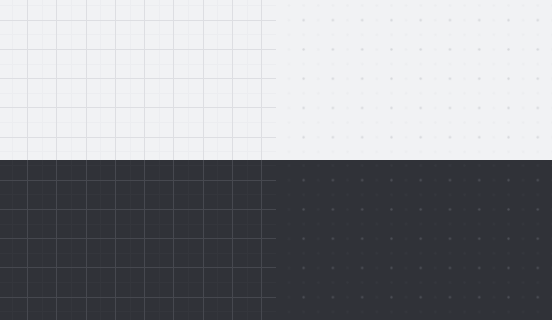

Исправлено открытие бланков XLSX с пустым разделом рисунков. При экспорте сохраняются границы пустых и объединённых ячеек. Крестик окна файла теперь расположен по центру кнопки.

В библиотеке доступны шаблоны, теги, сохранённые представления и поиск по содержимому. На доске появились инспектор, именованные области и режим презентации. [Все изменения с публичного выпуска 1.5.0](docs/RELEASE-2.3.19.md).

## Что такое RoadMax

**RoadMax — визуальное рабочее пространство, в котором идеи и материалы проекта остаются рядом.** Разложите заметки на свободной доске, соедините решения стрелками, добавьте изображения и документы. Откройте нужный файл прямо из контекста проекта — без обязательной загрузки в облако.

Здесь можно подготовить исследование, собрать материалы, спланировать запуск или организовать личные проекты. Проекты и папки в Dashboard помогают переходить от общей картины к конкретной доске, а встроенные редакторы — работать с её содержимым.

Текущий публичный выпуск — **2.3.21 от 14 ноября 2026 года**. В этом репозитории размещены сборки для Windows и macOS, документация и материалы для пользователей. Исходный код приложения хранится в закрытом репозитории.

## Возможности

| Задача | Что можно делать |
| :--- | :--- |
| **Собрать идеи** | Текст, стикеры, карточки, фигуры и рисунки на свободной доске. |
| **Связать решения** | Плавные, прямые и ортогональные стрелки, автоматические привязки и обход препятствий, ручные точки и стороны. Маршрут обновляется во время перемещения. |
| **Организовать проекты** | Dashboard, проекты и вложенные папки, избранное, недавние доски, поиск по названиям, превью и корзина. |
| **Редактировать доску** | Групповое выделение, перемещение и размеры объектов, дублирование, выравнивание, порядок слоёв и Undo/Redo. Мини-карта и масштаб помогают ориентироваться. |
| **Работать с PDF** | Чтение, поиск по текстовому слою, заметки и рисованные пометки, выбор и поворот нескольких страниц, удаление, перестановка и вставка страниц из другого PDF, экспорт и печать. |
| **Редактировать изображения** | Поворот и отражение, обрезка, перо, линия, стрелка, рамка и текст. Выбор и перемещение пометок, Undo/Redo, экспорт PNG/JPEG/WebP. |
| **Вести таблицы** | XLSX, CSV и TSV: листы, ячейки и диапазоны, копирование/вставка, строки и столбцы, оформление, форматы чисел и дат, сортировка и фильтры. Вычисление формул со ссылками между листами, экспорт XLSX. |
| **Готовить документы** | DOCX: абзацы и заголовки, шрифты и начертания, списки, ссылки, таблицы, изображения, поиск и Undo/Redo. Сохранение DOCX и локальный экспорт PDF. |
| **Хранить и переносить** | Локальное сохранение, резервные копии .flowboard и переносимые проекты .roadmax с вложениями. Оригинал файла и рабочая версия хранятся отдельно. |

## Интерфейс RoadMax 2.3.19

На снимках открыт демонстрационный проект «Запуск продукта». Нажмите на снимок, чтобы рассмотреть его в полном размере.

| Экран | Светлая тема | Тёмная тема |
| :--- | :---: | :---: |
| **Доска** | [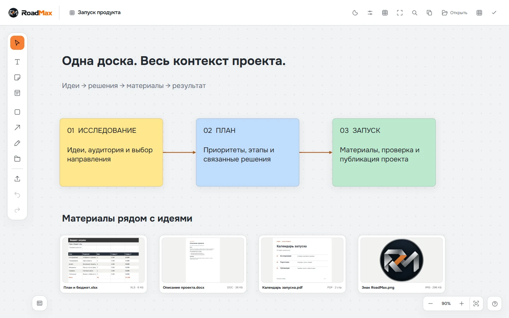](assets/screenshots/2.3.19/board-light.webp) | [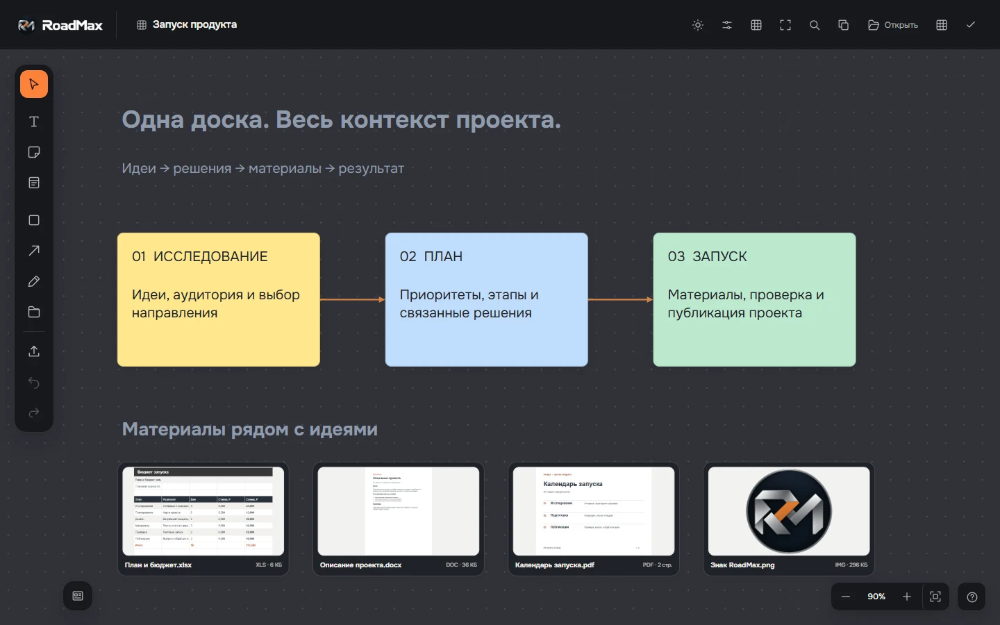](assets/screenshots/2.3.19/board-dark.webp) |
| **Библиотека проектов** |  | [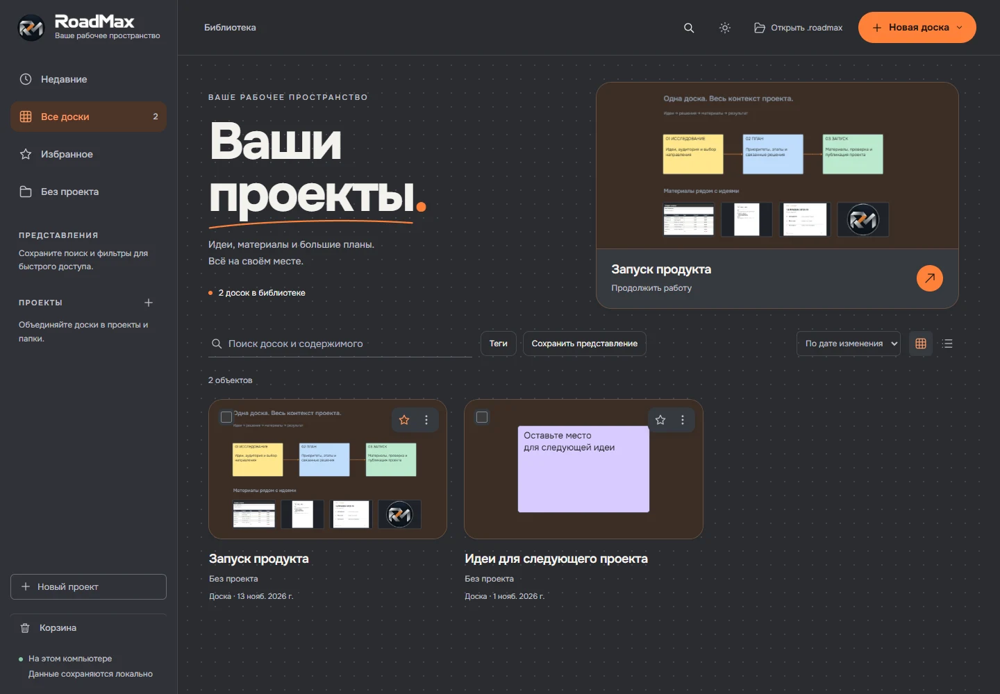](assets/screenshots/2.3.19/library-dark.webp) |
| **Редактор PDF** | [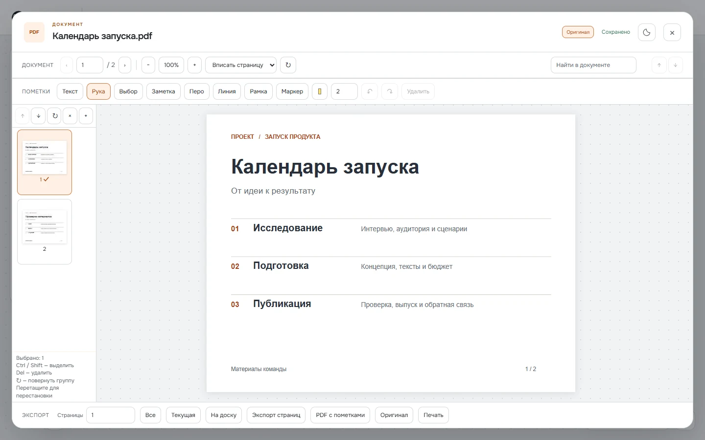](assets/screenshots/2.3.19/pdf-light.webp) | [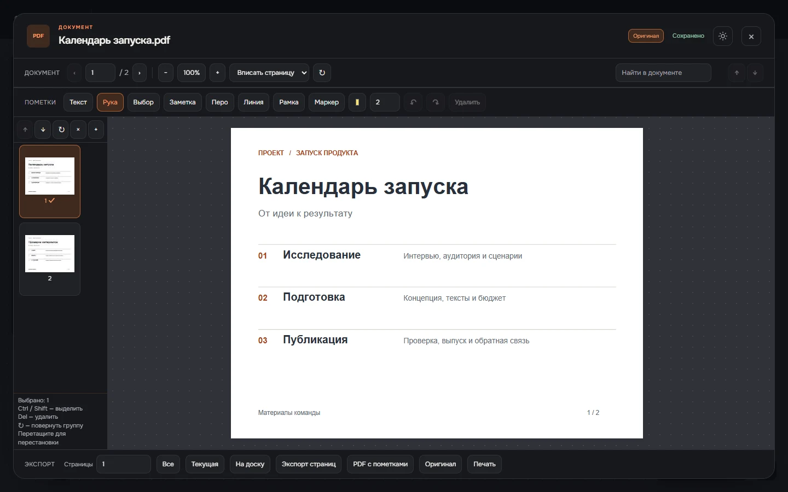](assets/screenshots/2.3.19/pdf-dark.webp) |
| **Редактор изображений** | [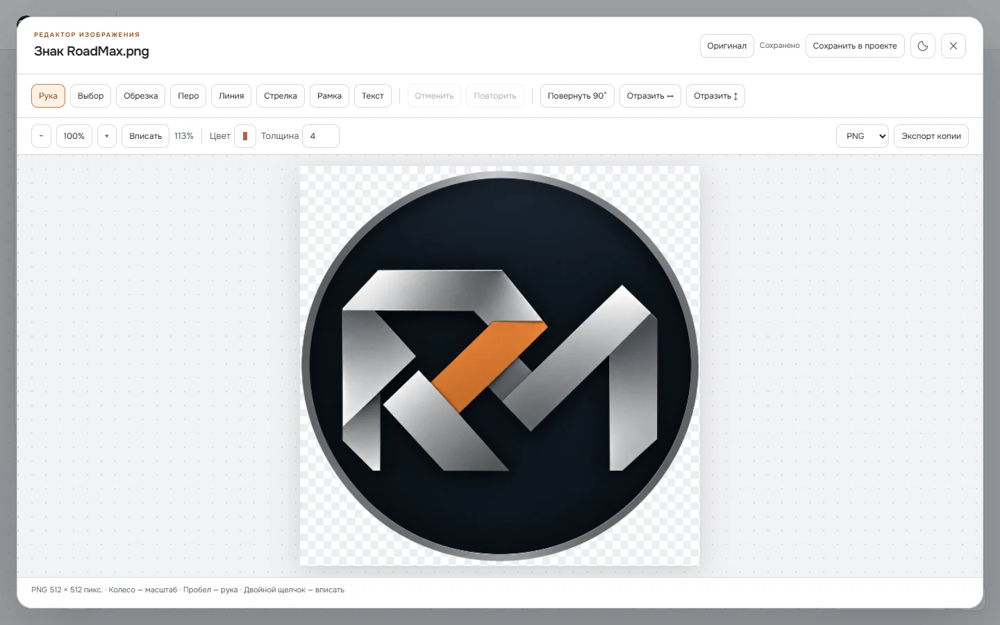](assets/screenshots/2.3.19/image-light.webp) | [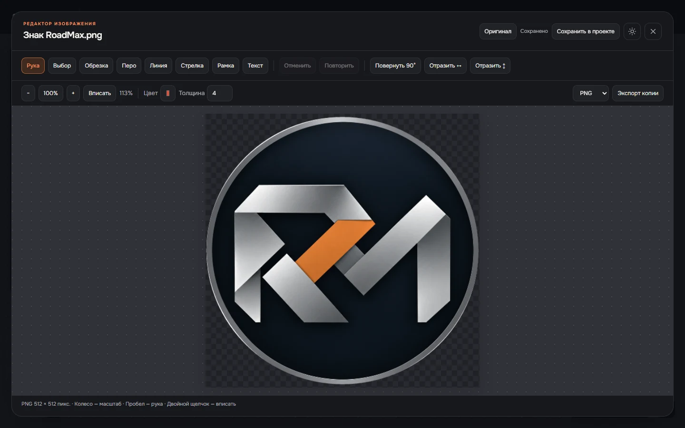](assets/screenshots/2.3.19/image-dark.webp) |
| **Таблица XLSX** | [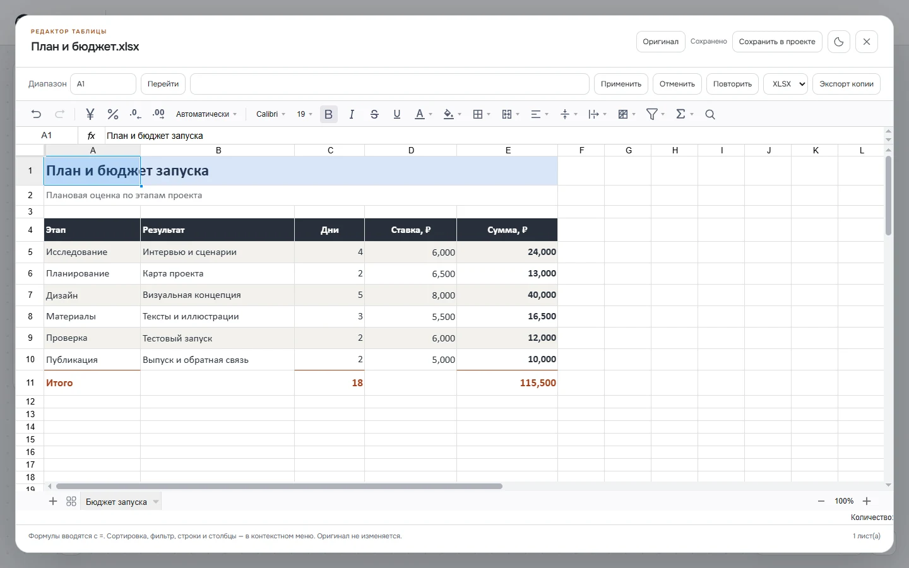](assets/screenshots/2.3.19/sheet-light.webp) | [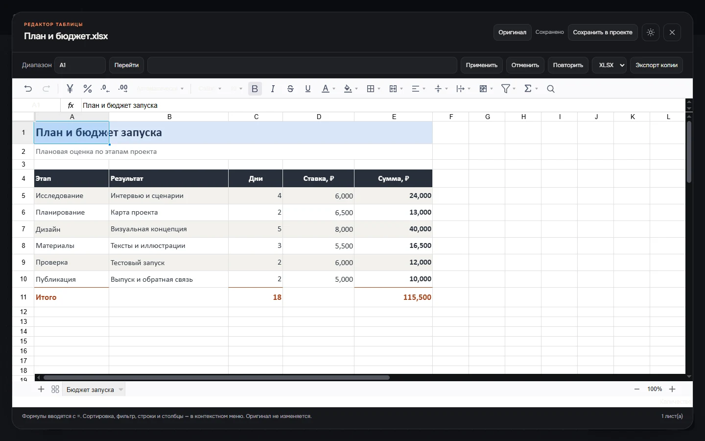](assets/screenshots/2.3.19/sheet-dark.webp) |
| **Документ DOCX** | [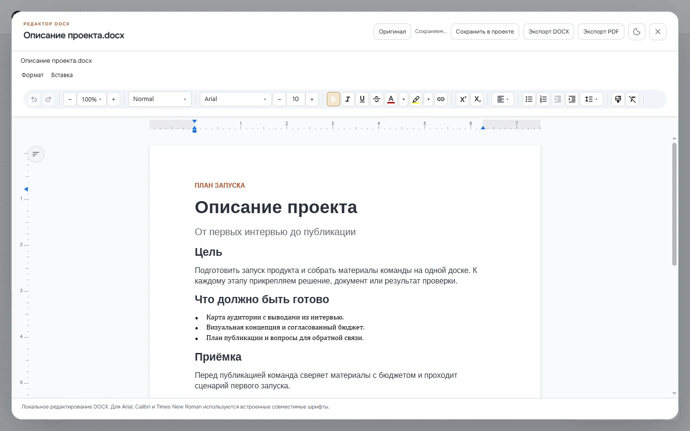](assets/screenshots/2.3.19/docx-light.webp) | [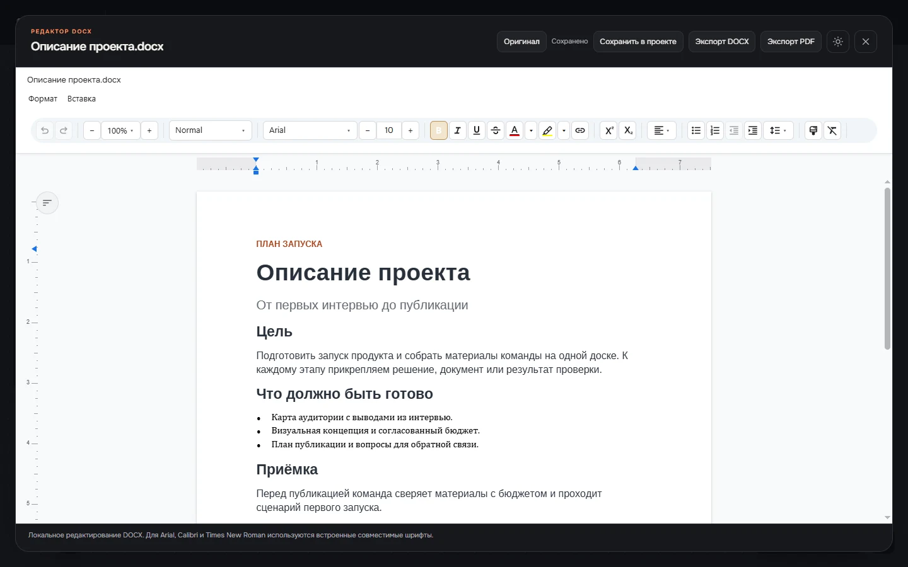](assets/screenshots/2.3.19/docx-dark.webp) |

Работа с файлами на доске

- **PDF.** Колесо меняет масштаб около указателя, временная «Рука» включается удержанием пробела. Двойной щелчок вписывает PDF в окно во всех инструментах; предпросмотр на доске тоже поддерживает масштаб и перемещение.
- **Изображения.** Поворот, отражение и обрезка; пометки с выбором цвета и толщины; сохранение рабочей версии и экспорт копии. Исходные байты вложения сохраняются.
- **Таблицы.** Формулы вычисляются встроенным табличным движком. В контрольной книге проверены SUM, AVERAGE, MIN, MAX, COUNT, IF и ссылка на лист с кириллическим названием.
- **DOCX.** Редактирование и экспорт выполняются локально. Microsoft Word и облачный сервис для этих действий не требуются.

## Скачать и запустить

**macOS.** Скачайте DMG для своего процессора, откройте образ и перетащите RoadMax в «Программы».

**Windows.**

1. Скачайте **[RoadMax-Portable-2.3.21.exe](https://github.com/FORQO/RoadMax-Public/releases/download/v2.3.21/RoadMax-Portable-2.3.21.exe)** из раздела Assets релиза.
2. Если RoadMax уже открыт, завершите его и запустите новый EXE. Установка не нужна.
3. Доски и вложения сохраняются в `%APPDATA%\Flowboard\boards`. Portable запускается без установки, но данные не лежат рядом с EXE.
4. Перед обновлением существующих данных создайте резервную копию через меню «Файл». Для переноса доски копируйте всю экспортированную папку: файл .roadmax и расположенные рядом вложения.

Файл не имеет цифровой подписи издателя. Автоматическое обновление пока отсутствует. Сверить скачивание можно по **[SHA256SUMS.txt](https://github.com/FORQO/RoadMax-Public/releases/download/v2.3.21/SHA256SUMS.txt)**; подробное управление — в **[краткой инструкции](docs/QUICK-START-RU.md)**.

## Форматы и ограничения

| Форматы | Поддержка в 2.3.19 |
| :--- | :--- |
| **PNG, JPEG/JPG/JFIF, WebP, BMP, AVIF** | Просмотр, базовое редактирование, оригинал, экспорт PNG/JPEG/WebP. |
| **APNG, GIF, анимированный WebP** | Просмотр анимации. Для редактирования явно выбирается первый кадр; полная анимация остаётся в оригинале. |
| **SVG, TIFF/TIF, ICO, HEIC/HEIF** | Поддержанные безопасные файлы открываются локально. Перед редактированием показано ограничение: растеризация, одна страница или одно изображение контейнера. Активный/внешний SVG не редактируется. |
| **RAW, PSD, AI** | Специального движка нет; доступен оригинал и показано ограничение. |
| **XLSX, CSV, TSV** | Просмотр и редактирование поддержанных книг. CSV/TSV экспортирует один лист значениями в UTF-8 с BOM после подтверждения потери формул/оформления. |
| **XLS, ODS, XLSM, XLSB** | Сохранение оригинала; для редактирования преобразуйте копию в XLSX внешним приложением. |
| **DOCX** | Поддержанные документы редактируются локально. Сложные неподдержанные конструкции отключают редактирование заранее; исходник доступен отдельно. |
| **DOC, RTF, DOCM** | Требуется внешнее преобразование копии в DOCX без макросов. |

Сложные Office-файлы могут отображаться не полностью. Диаграммы, отслеживаемые правки, формы и другие неподдержанные элементы не должны исчезать при случайном пересохранении: для таких файлов включается режим просмотра/оригинала. Активный код и макросы не исполняются. Полного совпадения со всеми версиями Word и всеми авторскими шрифтами не обещается.

В XLSX активный фильтр экспортируется диапазоном и текущими скрытыми строками, без критериев; требуется явное подтверждение. Для сканированного PDF без текстового слоя поиск по словам недоступен — OCR в выпуск не входит.

Основная платформа выпуска — **Windows x64**. Синхронизация между компьютерами, облако и совместное редактирование пока отсутствуют. [Ограничения и проверки выпуска 1.5.0](docs/VERIFICATION-1.5.0.md).

## Проверки выпуска 2.3.19

В готовом Portable проверены оба режима сетки, открытие и редактирование XLSX, сохранение проекта и экспорт копии. Также прошли 59 тестов хранилища, обработки таблиц и масштабирования. [Подробности проверки](docs/RELEASE-2.3.19.md).

### Архив проверок 1.5.0

Итоговый Portable прошёл **197 модульных тестов и 16 нативных сценариев** на синтетических профилях, а также проверки типов, lint и сборки. Проверены повторный запуск, перенос проектов и backup, сохранение оригиналов и восстановление после внедрённых отказов записи. Экспорты изображений, XLSX, DOCX и PDF дополнительно открыты независимыми инструментами.

Стрелки проверены в движении на реконструированной контрольной сцене при 55/100/200/400%. На каждой траектории — 169 кадров без пересечения карточек; это результат конкретных сцен, а не гарантия глобально кратчайшего маршрута для любой доски. [Подробности приёмки](docs/VERIFICATION-1.5.0.md) · [История развития по отчётам](docs/HISTORY.md).

## Вопросы и предложения

**[Сообщить об ошибке или предложить улучшение](https://github.com/FORQO/RoadMax-Public/issues/new/choose)**

Укажите версию RoadMax, Windows, шаги воспроизведения, ожидаемый и фактический результат. Для примеров используйте демонстрационные файлы без личных данных. Чтобы следить за выпусками, можно включить **Watch → Custom → Releases**.

Лицензии сторонних компонентов и исходники LGPL-кодеков приложены к релизу. [Состав поставки и происхождение снимков версии 1.5.0](docs/RELEASE-MANIFEST.json).

---

<b>RoadMax · FORQO</b> От идеи к результату — сохраняя контекст.

