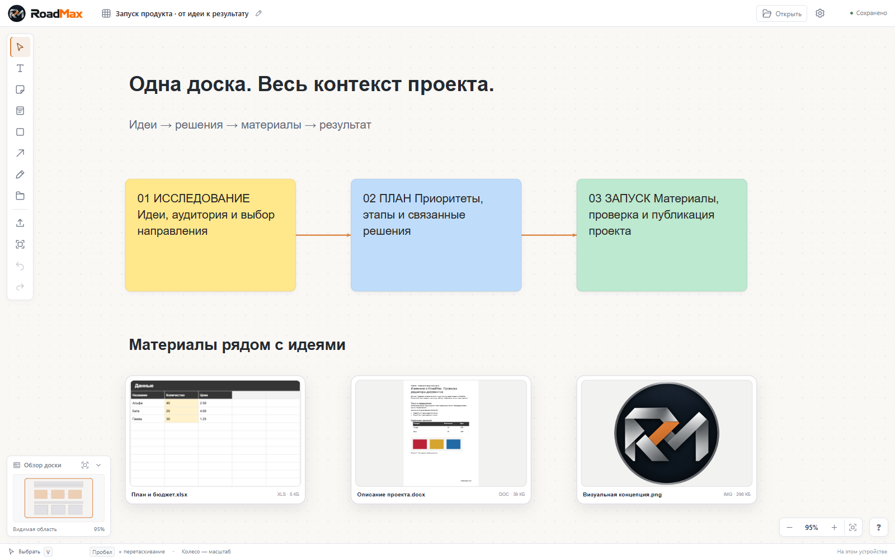
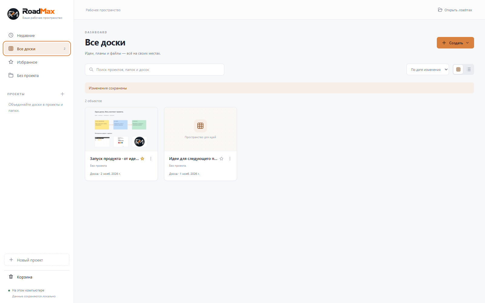
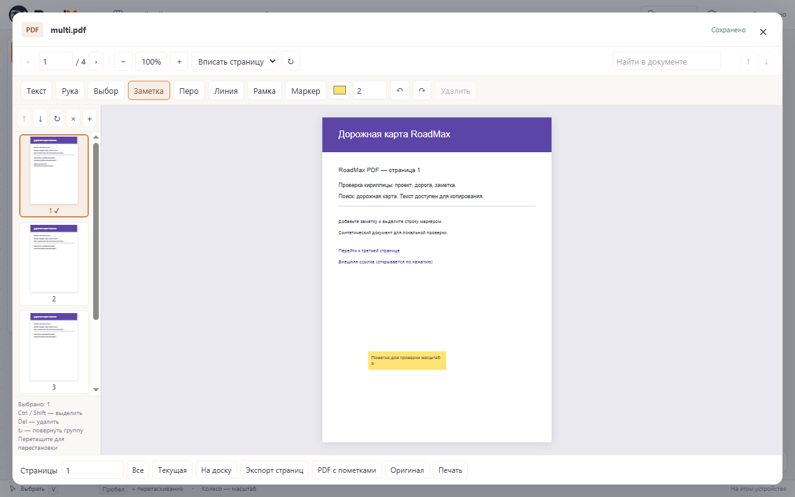
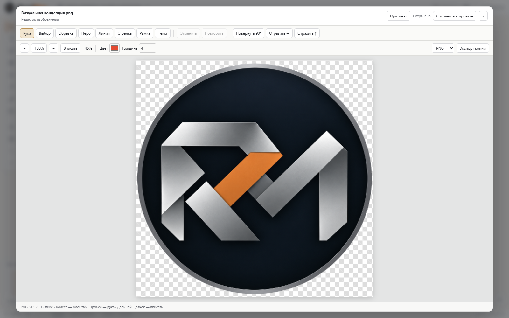
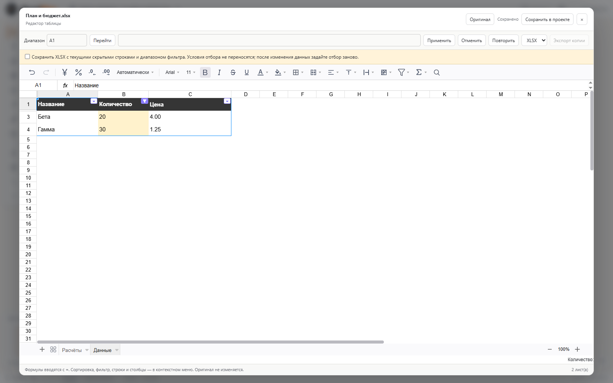
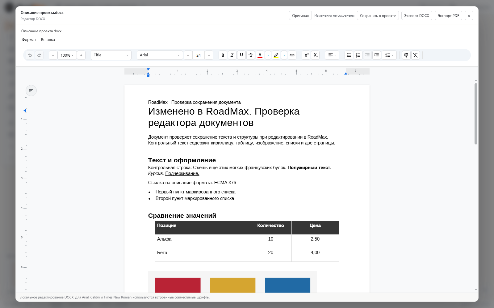

 

<b>Идеи, планы и документы — в одном пространстве.</b> Локальное приложение для Windows от <a href="https://github.com/FORQO">FORQO</a>.

<a href="https://github.com/FORQO/RoadMax-Public/releases/download/v1.5.0/RoadMax-Portable-1.5.0-Windows-x64.exe"><b>Скачать RoadMax 1.5.0 · Windows x64 · Portable</b></a> <a href="https://github.com/FORQO/RoadMax-Public/releases/tag/v1.5.0">Релиз и контрольные суммы</a> · <a href="docs/QUICK-START-RU.md">Как начать</a> · <a href="https://github.com/FORQO/RoadMax-Public/issues/new/choose">Обратная связь</a>

## Что такое RoadMax

**RoadMax — визуальное рабочее пространство, в котором идеи и материалы проекта остаются рядом.** Разложите заметки на свободной доске, соедините решения стрелками, добавьте изображения и документы. Откройте нужный файл прямо из контекста проекта — без обязательной загрузки в облако.

Здесь можно подготовить исследование, собрать материалы, спланировать запуск или организовать личные проекты. Проекты и папки в Dashboard помогают переходить от общей картины к конкретной доске, а встроенные редакторы — работать с её содержимым.

**Первый публичный выпуск — 1.5.0 от 2 ноября 2026 года.** Он объединяет накопленные улучшения доски и хранения данных, Dashboard, работу с PDF, оформление Titanium, исправленные стрелки и новые редакторы изображений, таблиц и DOCX. Исходный код приложения закрыт; этот репозиторий содержит публичные материалы, документацию и выпуски.

## Возможности

| Задача | Что можно делать |
| :--- | :--- |
| **Собрать идеи** | Текст, стикеры, карточки, фигуры и рисунки на свободной доске. |
| **Связать решения** | Плавные, прямые и ортогональные стрелки, автоматические привязки и обход препятствий, ручные точки и стороны. Маршрут обновляется во время перемещения. |
| **Организовать проекты** | Dashboard, проекты и вложенные папки, избранное, недавние доски, поиск по названиям, превью и корзина. |
| **Редактировать доску** | Групповое выделение, перемещение и размеры объектов, дублирование, выравнивание, порядок слоёв и Undo/Redo. Мини-карта и масштаб помогают ориентироваться. |
| **Работать с PDF** | Чтение, поиск по текстовому слою, заметки и рисованные пометки, выбор и поворот нескольких страниц, удаление, перестановка и вставка страниц из другого PDF, экспорт и печать. |
| **Редактировать изображения** | Поворот и отражение, обрезка, перо, линия, стрелка, рамка и текст. Выбор и перемещение пометок, Undo/Redo, экспорт PNG/JPEG/WebP. |
| **Вести таблицы** | XLSX, CSV и TSV: листы, ячейки и диапазоны, копирование/вставка, строки и столбцы, оформление, форматы чисел и дат, сортировка и фильтры. Вычисление формул со ссылками между листами, экспорт XLSX. |
| **Готовить документы** | DOCX: абзацы и заголовки, шрифты и начертания, списки, ссылки, таблицы, изображения, поиск и Undo/Redo. Сохранение DOCX и локальный экспорт PDF. |
| **Хранить и переносить** | Локальное сохранение, резервные копии .flowboard и переносимые проекты .roadmax с вложениями. Оригинал файла и рабочая версия хранятся отдельно. |

## Текущий интерфейс

Все снимки ниже получены из **того же Portable 1.5.0, который приложен к релизу**. Использованы демонстрационные данные. На снимках — работающее приложение с новым знаком и надписью RoadMax, а не макеты.

### Dashboard — порядок в проектах

### PDF — страницы и пометки

Колесо меняет масштаб около указателя, временная «Рука» включается удержанием пробела. Двойной щелчок вписывает PDF в окно во всех инструментах; предпросмотр на доске тоже поддерживает масштаб и перемещение.

### Изображения — базовый редактор

Поворот, отражение и обрезка; пометки с выбором цвета и толщины; сохранение рабочей версии и экспорт копии. Исходные байты вложения сохраняются.

### Таблицы — листы, значения и формулы

Формулы вычисляются полноценным табличным движком. В контрольной книге проверены SUM, AVERAGE, MIN, MAX, COUNT, IF и ссылка на лист с кириллическим названием.

### DOCX — документ прямо в программе

Редактирование и экспорт выполняются локально. Microsoft Word и облачный сервис для этих действий не требуются.

## Скачать и запустить

1. Скачайте **[RoadMax-Portable-1.5.0-Windows-x64.exe](https://github.com/FORQO/RoadMax-Public/releases/download/v1.5.0/RoadMax-Portable-1.5.0-Windows-x64.exe)** из раздела Assets релиза.
2. Если RoadMax уже открыт, завершите его и запустите новый EXE. Установка не нужна.
3. Доски и вложения сохраняются в `%APPDATA%\Flowboard\boards`. Portable запускается без установки, но данные не лежат рядом с EXE.
4. Перед обновлением существующих данных создайте резервную копию через меню «Файл». Для переноса доски копируйте всю экспортированную папку: файл .roadmax и расположенные рядом вложения.

Файл не имеет цифровой подписи издателя. Автоматическое обновление пока отсутствует. Сверить скачивание можно по **[SHA256SUMS.txt](https://github.com/FORQO/RoadMax-Public/releases/download/v1.5.0/SHA256SUMS.txt)**; подробное управление — в **[краткой инструкции](docs/QUICK-START-RU.md)**.

## Форматы и ограничения

| Форматы | Поддержка в 1.5.0 |
| :--- | :--- |
| **PNG, JPEG/JPG/JFIF, WebP, BMP, AVIF** | Просмотр, базовое редактирование, оригинал, экспорт PNG/JPEG/WebP. |
| **APNG, GIF, анимированный WebP** | Просмотр анимации. Для редактирования явно выбирается первый кадр; полная анимация остаётся в оригинале. |
| **SVG, TIFF/TIF, ICO, HEIC/HEIF** | Поддержанные безопасные файлы открываются локально. Перед редактированием показано ограничение: растеризация, одна страница или одно изображение контейнера. Активный/внешний SVG не редактируется. |
| **RAW, PSD, AI** | Специального движка нет; доступен оригинал и показано ограничение. |
| **XLSX, CSV, TSV** | Просмотр и редактирование поддержанных книг. CSV/TSV экспортирует один лист значениями в UTF-8 с BOM после подтверждения потери формул/оформления. |
| **XLS, ODS, XLSM, XLSB** | Сохранение оригинала; для редактирования преобразуйте копию в XLSX внешним приложением. |
| **DOCX** | Поддержанные документы редактируются локально. Сложные неподдержанные конструкции отключают редактирование заранее; исходник доступен отдельно. |
| **DOC, RTF, DOCM** | Требуется внешнее преобразование копии в DOCX без макросов. |

Сложные Office-файлы могут отображаться не полностью. Диаграммы, отслеживаемые правки, формы и другие неподдержанные элементы не должны исчезать при случайном пересохранении: для таких файлов включается режим просмотра/оригинала. Активный код и макросы не исполняются. Полного совпадения со всеми версиями Word и всеми авторскими шрифтами не обещается.

В XLSX активный фильтр экспортируется диапазоном и текущими скрытыми строками, без критериев; требуется явное подтверждение. Для сканированного PDF без текстового слоя поиск по словам недоступен — OCR в выпуск не входит.

Основная платформа выпуска — **Windows x64**. Синхронизация между компьютерами, облако и совместное редактирование пока отсутствуют. [Полные пределы и границы проверок](docs/VERIFICATION-1.5.0.md).

## Проверки выпуска

Итоговый Portable прошёл **197 модульных тестов и 16 нативных сценариев** на синтетических профилях, а также проверки типов, lint и сборки. Проверены повторный запуск, перенос проектов и backup, сохранение оригиналов и восстановление после внедрённых отказов записи. Экспорты изображений, XLSX, DOCX и PDF дополнительно открыты независимыми инструментами.

Стрелки проверены в движении на реконструированной контрольной сцене при 55/100/200/400%. На каждой траектории — 169 кадров без пересечения карточек; это результат конкретных сцен, а не гарантия глобально кратчайшего маршрута для любой доски. [Подробности приёмки](docs/VERIFICATION-1.5.0.md) · [История развития по отчётам](docs/HISTORY.md).

## Вопросы и предложения

**[Сообщить об ошибке или предложить улучшение](https://github.com/FORQO/RoadMax-Public/issues/new/choose)**

Укажите версию RoadMax, Windows, шаги воспроизведения, ожидаемый и фактический результат. Для примеров используйте демонстрационные файлы без личных данных. Чтобы следить за выпусками, можно включить **Watch → Custom → Releases**.

Лицензии сторонних компонентов и исходники LGPL-кодеков приложены к релизу. [Состав поставки и происхождение снимков](docs/RELEASE-MANIFEST.json).

---

<b>RoadMax · FORQO</b> От идеи к результату — сохраняя контекст.

