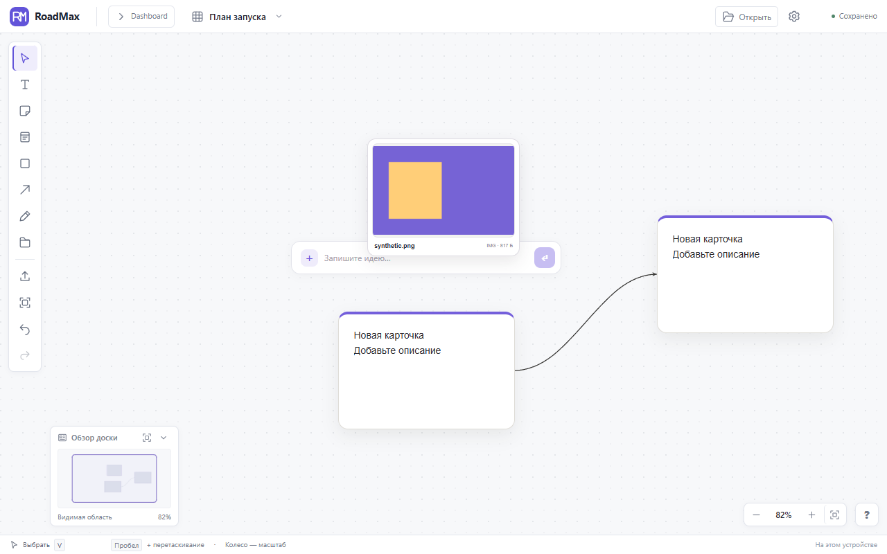
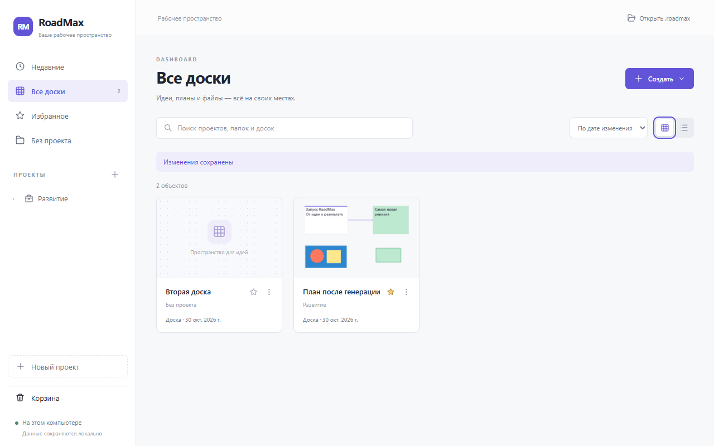
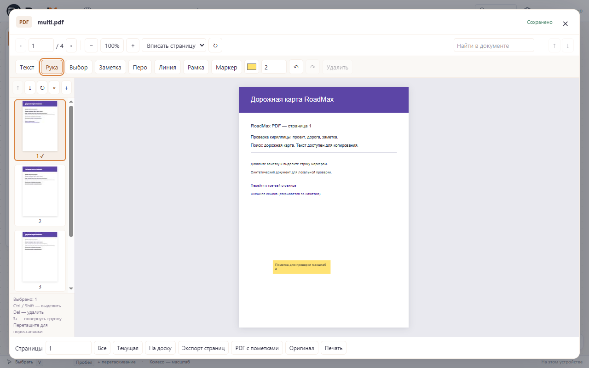

  

<b>Соберите идеи, связи и материалы проекта на одной доске.</b> Локальное приложение для Windows с русскоязычным интерфейсом.

<a href="#возможности">Возможности</a> · <a href="#скриншоты">Скриншоты</a> · <a href="#статус-и-доступность">Статус</a> · <a href="#что-дальше">Планы</a> · <a href="https://github.com/FORQO/RoadMax-Public/issues">Обратная связь</a>

## Что такое RoadMax

**RoadMax — визуальное рабочее пространство от [FORQO](https://github.com/FORQO).** Здесь можно разложить идеи и планы, соединить их в схему, прикрепить файлы и работать с документами, сохраняя контекст проекта.

Приложение подходит для подготовки проекта, исследования темы, организации личных материалов и планирования работы. Заметки, решения и вложения находятся рядом: от общей картины можно перейти к нужному документу.

**Проект активно развивается.** Эта страница знакомит с приложением; публичной сборки для скачивания пока нет. Исходный код RoadMax остаётся закрытым.

## Возможности

Возможности ниже реализованы в разрабатываемых Windows-сборках. Интерфейс и состав будущего публичного выпуска могут измениться.

| Задача | Что предлагает RoadMax |
| :--- | :--- |
| **Собрать идеи** | Текст, стикеры, карточки, фигуры и рисунки на свободной доске. |
| **Показать связи** | Соединения между объектами для схем, последовательностей и планов. |
| **Организовать работу** | Проекты, папки, доски, избранное, поиск по их названиям и превью в Dashboard. |
| **Держать материалы рядом** | Файлы и изображения на доске, предпросмотр вложений. |
| **Работать с PDF** | Просмотр, поиск по текстовому слою, пометки, операции со страницами и экспорт. |
| **Управлять изменениями** | Undo/Redo, групповое выделение, выравнивание и порядок слоёв. |
| **Хранить и переносить** | Локальное сохранение, резервные копии и экспорт проектов в формате `.roadmax` с вложениями. |

## Скриншоты

**Реальные снимки Windows-сборок от 29–30 октября 2026 года.** На них используются тестовые материалы. Это интерфейс работающего приложения, а не макеты; оформление отдельных сборок отличается и продолжает развиваться.

### Доска: идеи, карточки и связи

Размещайте материалы свободно и показывайте, как отдельные части проекта связаны друг с другом.

*Карточки, вложение, связь между объектами и мини-карта. Снимок тестовой сборки от 29 октября 2026 года.*

### Dashboard: порядок в проектах

Переключайтесь между досками, находите нужные материалы по названию и узнавайте их по превью.

*Проекты, избранное, поиск и плитки досок с миниатюрами. Снимок от 30 октября 2026 года.*

### PDF: документ внутри рабочего пространства

Открывайте PDF с доски, перемещайтесь по страницам, находите текст и добавляйте пометки.

*Панель страниц, масштабирование, заметки, инструменты рисования и экспорт. Снимок тестовой сборки от 30 октября 2026 года.*

## Статус и доступность

| | Сейчас |
| :--- | :--- |
| **Основная платформа** | Windows x64 |
| **Стадия** | Активная разработка и тестирование |
| **Скачивание** | Публичная сборка пока не опубликована |
| **Исходный код** | Закрыт; этот репозиторий содержит только публичные материалы |
| **Данные** | Основные сценарии работают локально на компьютере |
| **Облако и совместное редактирование** | Пока не поддерживаются |

Когда публичная сборка будет готова, информация о доступности появится здесь. Дата выпуска пока не объявлена.

## Что дальше

- **Изображения:** просмотр и базовое редактирование внутри приложения.
- **Таблицы и Word-документы:** работа с ними непосредственно в RoadMax.
- **Стабильность:** сохранность данных, удобство навигации и проверка сквозных сценариев перед выпуском.

Это направления разработки, а не обещание функций или сроков ближайшего релиза.

## Вопросы и предложения

Расскажите, для каких задач вам нужен RoadMax и чего не хватает в описанных сценариях.

**[Задать вопрос или предложить улучшение](https://github.com/FORQO/RoadMax-Public/issues/new/choose)**

Если у вас уже есть тестовая сборка и вы нашли ошибку, укажите её версию, Windows, шаги воспроизведения и ожидаемый результат. Публикуйте только демонстрационные материалы без личных данных.

Чтобы следить за новостями, сохраните репозиторий в избранное через **Star** или настройте **Watch**.

---

<b>RoadMax · FORQO</b> Идеи, планы и документы — в одном пространстве. <a href="https://github.com/FORQO">Другие проекты FORQO</a>

